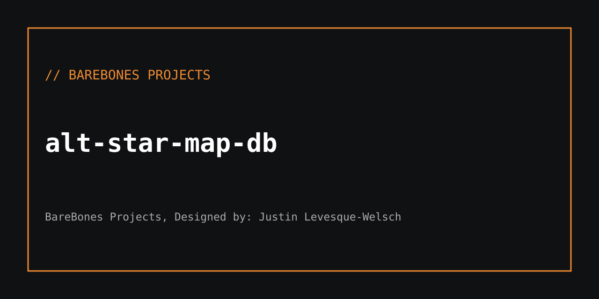

<!-- ALT-SIGNATURE-BEGIN:ALT_HEADER_SIGNED
@ALT_HEADER_SIGNED
========================================================================
Copyright (c) 2026 [Your Name or Company Name]. All rights reserved.
Portions of this project may utilize open-source components or assets
licensed under separate terms. See LICENSE or NOTICE files for details.
========================================================================
@BAREMARK_VERIFIED_PENDING
ALT-SIGNATURE-END:ALT_HEADER_SIGNED -->

# alt-star-map-db

Cyclus Milky Way Map - 1:50,000 Scale - Black & White Wireframe Locked

## BareBones-Projects/alt-star-map-db

### Current Build: BATCH 1-6 DONE - 45,000 bodies (15k stars / 15k planets / 15k moons) - 0-2500 ly

### Theme: BLACK & WHITE WIREFRAME LOCKED 🔒
- Background: #000 black
- Foreground: #fff white wireframe only
- Crosshair stars, box planets, grid toggle
- Monospace, no colors

### Scale
- 1:50,000
- Local: Sun at 0,0,0 ly
- Galactic: GC 0,0,0, Sun at -26673,0,66 ly
- Scaled: real_m = ly * 9.4607e15 / 50000

### Batches
| Batch | Range | Count | Status |
|-------|-------|-------|--------|
| B1 | 0-150 ly | 7500 | DONE - Trappist-1 CORE |
| B2 | 150-300 ly | 7500 | DONE |
| B3 | 300-600 ly | 7500 | DONE |
| B4 | 600-1000 ly | 7500 | DONE |
| B5 | 1000-1500 ly | 7500 | DONE |
| B6 | 1500-2500 ly | 7500 | DONE |
| **Total** | **0-2500 ly** | **45k** | **LOCKED** |

### Files
- `data/sample_100.csv` - 100 rows sample (commits)
- `viewers/index.html` - Master B&W wireframe viewer (locked)
- `database/` - SQLite clone (via Release, not commit)
- `docs/` - Naming + GitHub fix

### Large Files (via Releases, not commit)
Due to GitHub 100MB limit:
- `cyclus_CUMULATIVE_15000_each.csv` (45k bodies, ~15MB) - Release asset
- `cyclus_milkyway_clone.db` (~8MB) - Release asset

Download from Releases tab.

### Image Naming (for planet renders from other chats)
`{Parent}_{Body}_{type}_{Batch}_{Version}.png`
Example: `Trappist-1_e_planet_B1_CORE_v01.png`

Link to DB: `python scripts/link_images.py`

### How to run viewer
Open `viewers/index.html` in browser - drag to rotate, scroll zoom, [W] wireframe toggle

## License
MIT - BareBones Projects

## // ALT Database integration

The canonical hub is [BareBones-Projects/ALT-Database](https://github.com/BareBones-Projects/ALT-Database). This repository retains its existing map viewer and release assets. Read-only canonical star snapshots can be exported with `python scripts/fetch_alt_database.py --base http://127.0.0.1:8090`. See `integrations/README.md`. This adapter does not import 45,000 bodies automatically; CSV provenance/coordinate validation is required first.
<!-- ALT-SIGNATURE-BEGIN:ALT_FOOT_SIGNED
@ALT_FOOT_SIGNED
========================================================================
Copyright (c) 2026 [Your Name or Company Name]. All rights reserved.
Portions of this project may utilize open-source components or assets
licensed under separate terms. See LICENSE or NOTICE files for details.
========================================================================
@BAREMARK_VERIFIED_PENDING
ALT-SIGNATURE-END:ALT_FOOT_SIGNED -->

---
BareBones Projects, Designed by: Justin Levesque-Welsch
